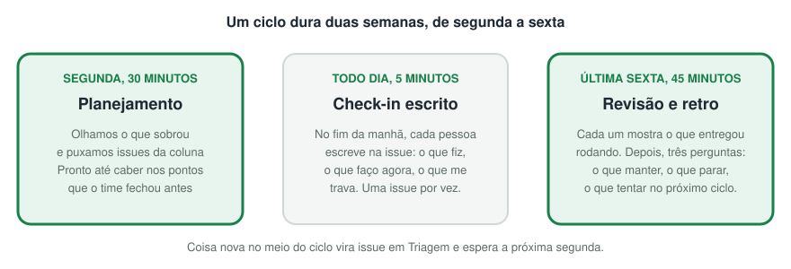

# EM Vidros

A EM Vidros beneficia e tempera vidro e atende clientes de todo o Norte e Nordeste. A matriz fica em Raposa, no Maranhão, e produz em escala industrial. A filial de Imperatriz atende a região.

Este é o perfil do time de desenvolvimento da empresa. Aqui estão os sistemas que construímos para a operação e o jeito como trabalhamos.

## O que construímos

Cada sistema nasce de um problema que a operação já tinha, e não de uma ferramenta que queríamos usar.

- **Atendimento.** A tela e a API com que a equipe responde clientes no WhatsApp, e um bot que encaminha cada cliente para a filial certa.
- **Indicadores.** Painéis de metas e comissões que substituem planilhas montadas à mão.
- **Agentes de IA.** Assistentes que ajudam consultores e a expedição a montar pedidos e a responder mais rápido.
- **Site e marketing.** O site institucional e a automação do conteúdo de redes sociais.

A maior parte do código é privada. Os repositórios públicos estão na lista da organização.

## Como trabalhamos

Somos poucas pessoas, então usamos só o processo que ajuda.

  

- **Ciclos de duas semanas.** Planejamos na segunda e fechamos na sexta, mostrando o que ficou pronto rodando.
- **Issue pequena, com critério de aceite.** Cada tarefa diz o que fazer, como saber que acabou e o que fica de fora. Usamos só três tamanhos, 1, 3 e 8 pontos.
- **Uma coisa por vez.** Cada pessoa tem uma issue em andamento.
- **Pull request pequeno.** Toda mudança passa por testes automáticos e por revisão de uma pessoa do time.
- **Deploy automático.** O que entra na `main` e passa pela CI sobe sozinho para produção, com volta automática se a versão nova falhar.

Quem faz parte da organização encontra o processo completo no repositório `processo-agil` e a trilha de onboarding do Atend no repositório `atend`.

## Contato

- Dúvidas sobre os sistemas: abra uma issue no repositório do sistema, se você tiver acesso.
- Comercial e geral: `contato@emvidros.com.br` ou `(98) 3131-4000`.
- Site: [emvidros.com.br](http://www.emvidros.com.br)
- Sede: Rua do Campo, 100, Inhaúma, Raposa, MA.
